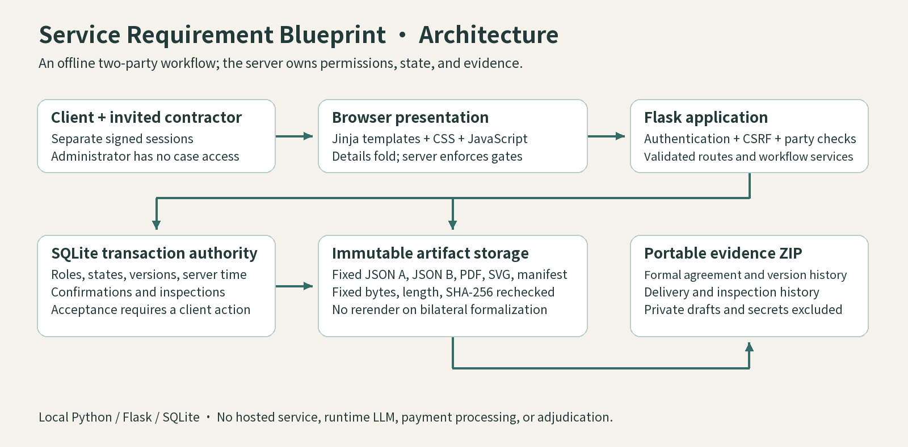
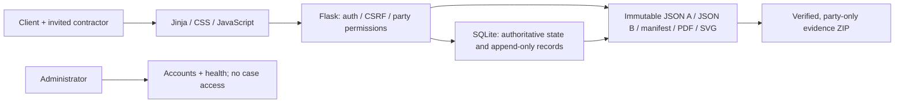
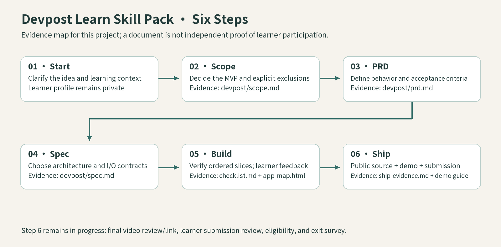
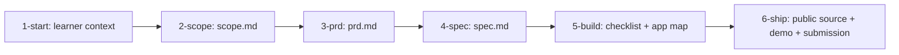

# Service Requirement Blueprint

Service Requirement Blueprint is an English-only, local competition proof of concept for turning a vague website request into a versioned agreement and a traceable delivery review. A client and one invited contractor can establish the same requirement and quote sources, confirm the same fixed PDF, record delivery and tests, return specific items for remediation, explicitly accept a reinspection, or preserve both positions in a dispute evidence export.

The project follows the Devpost Learn AI Basics workflow. Its canonical planning files are `devpost/scope.md`, `devpost/prd.md`, `devpost/spec.md`, and `devpost/checklist.md`.

## Architecture at a glance



<details>
<summary>Editable Mermaid architecture</summary>



</details>

## Official Skill Pack workflow and project evidence





The official [Devpost Learn Skill Pack](https://github.com/challengepost/learn-ai-basics) contains these six numbered stages. The project's public evidence is [Scope](devpost/scope.md), [PRD](devpost/prd.md), [Spec](devpost/spec.md), [Build checklist](devpost/checklist.md), [App Map](devpost/app-map.html), and [Ship evidence](devpost/ship-evidence.md). The learner profile is excluded for privacy. Planning approvals and historical tests are records of the process; they do not independently prove every learner interaction or certify a later runtime.

**Current handoff:** the edited demo candidate is 161.8 seconds at 1.1× speed (23 scenes, 39 captions). The public source update is authorized. Final human audiovisual review, a hosted video URL, learner review/completion of the AI-assisted submission draft, eligibility answers, and the exit survey remain open; Step 6 is not marked fully complete. See the [current capture guide](devpost/demo-capture-guide.md). The [official rules](https://learn-ai-basics.devpost.com/rules) require a working PoC, public source with planning documents, and a demonstration video; hosted application deployment is not required. Judges may choose to test the project.

## Implemented journey

1. The client completes eight guided requirement sections and downloads immutable JSON A bytes.
2. A single-use invitation binds one approved contractor to one private case.
3. The contractor imports the exact JSON A, discusses open questions, and submits an immutable JSON B review version.
4. The contractor creates one fixed candidate manifest, PDF, and SVG from the current JSON A and JSON B.
5. Both parties acknowledge and confirm the same five-file evidence set. Formalization changes database state and does not regenerate any file.
6. The contractor submits an immutable delivery record with one delivery item and test result for every formal acceptance criterion.
7. The client explicitly begins inspection and either accepts every item or returns identified items with reasons. Remediation creates a new delivery version and a new reinspection.
8. After a delivery is submitted and before acceptance, either party may open a dispute. The platform preserves each party's final position and does not decide the outcome.
9. In an accepted or disputed case, either party may prepare and download the fixed evidence ZIP for the current evidence state. Earlier packages remain listed as superseded history and cannot be downloaded as current evidence.

## Security and evidence boundaries

- `/en/<path>` is the only product route family. The architecture retains a dormant catalog seam, but no additional locale is shipped.
- Every mutation uses POST and CSRF validation. Signed-in sessions store the user ID, session version, and CSRF nonce; a signed-out invitation handoff may briefly store an invitation ID until sign-in.
- Roles, case membership, versions, timestamps, and workflow state come from current SQLite data, never from uploaded authority fields or cookies.
- Administrators can manage demonstration accounts and service health. Administrator status does not grant case access.
- Formal candidate files and submitted delivery, inspection, explicit acceptance, timeline, dispute, and export records are append-only.
- The competition build allows at most 20 immutable delivery versions per case.
- Silence, review deadlines, page views, restart, and delivery notices never create acceptance.
- Evidence exports use an explicit allowlist: the formal manifest, PDF, SVG, JSON A, JSON B, delivery records, inspections, deadline events, and dispute positions.
- Evidence exports exclude requirement drafts, private JSON B drafts and private exports, credentials, sessions, CSRF values, invitation secrets, logs, administrator data, absolute paths, and unrelated cases.
- Every fixed download is reauthorized and checked against its controlled path, regular-file type, byte length, and SHA-256 digest. Evidence ZIP downloads also validate the manifest schema, canonical entry set, every inner length and digest, and the fingerprint of the current case evidence inside one database read snapshot. A package becomes superseded when later evidence changes that fingerprint. Delivery views and startup recompute inspection consistency and the explicit-acceptance evidence digest.
- Runtime generation and the complete demonstration journey work offline after dependencies are installed.

This PoC does not provide payment, escrow, refunds, email delivery, OAuth, external signatures, legal advice, contract adjudication, public case discovery, deployment, or cloud storage. It does not claim end-to-end encryption or protection from a person who can directly read the local operating system, SQLite database, or artifact directory. It does not promise permanent retention or legal effect in a particular jurisdiction.

## Requirements

- Python 3.12
- Network access only for the first dependency installation

All resolved packages are pinned in `requirements.txt`.

## Setup

```bash
python3.12 -m venv .venv
.venv/bin/python -m pip install -r requirements.txt
```

Provide all three demonstration passwords through environment variables. Use a shell or process-manager mechanism that does not echo or save the values. Initialization has no default password and writes nothing when any password is missing.

```bash
export DEMO_OWNER_PASSWORD DEMO_CONTRACTOR_PASSWORD DEMO_ADMIN_PASSWORD
.venv/bin/python -m app.cli init-demo
POC_LOCAL_HTTP=1 .venv/bin/python -m app
```

Open `http://127.0.0.1:5000/`. The root redirects to `/en/`. Demonstration accounts are `owner@example.test`, `contractor@example.test`, and `admin@example.test`. The server binds only to loopback with debug mode and the reloader disabled.

If port 5000 is already in use, choose an available loopback port and use the same number in the start command and browser URL. For example, after confirming port 5051 is available:

```bash
POC_LOCAL_HTTP=1 POC_PORT=5051 .venv/bin/python -m app
```

Then open `http://127.0.0.1:5051/`. `POC_PORT` accepts ports 1024 through 65535; it changes only the local listening port.

Runtime state lives under ignored `instance/`. Passwords are stored as scrypt hashes. `instance/secret.key` must remain mode `0600`; changing it invalidates existing signed sessions. Fixed JSON, PDF, SVG, delivery, and ZIP artifacts live in controlled UUID paths and are not tracked by Git.

For an existing stopped local instance:

```bash
.venv/bin/python -m app.cli migrate
```

The command creates a private SQLite backup, applies repository migrations, and validates database integrity plus foreign keys. A current database returns `already_current`. Startup fails closed when a migration, formal artifact, fixed delivery record, or evidence export is missing, moved, malformed, or inconsistent with SQLite. Unreferenced delivery and export directories move to case-local quarantine.

## Verification

Run the complete deterministic suite:

```bash
.venv/bin/python -m pytest -q
```

Run the delivery and evidence gate alone:

```bash
.venv/bin/python -m pytest -q tests/test_slice7_delivery.py
```

The Slice 7 gate covers the return-remediation-reinspection-acceptance path, dispute positions, explicit consent, CSRF, active-party isolation, append-only parents and children, deadline non-consent, idempotent and concurrent requests, exact-byte export replay, startup reconciliation, outer and inner tamper rejection, schema enforcement, private-data sentinel exclusion, sanitized unexpected-error logs, and outbound-network denial.

Gate 0 remains available for fixed-font PDF and SVG preflight:

```bash
.venv/bin/python -m app.cli gate0
```

## Demonstration and submission evidence

- `devpost/demo-guide.md` contains the local two-session demonstration sequence.
- `devpost/ship-evidence.md` records factual build evidence, the authorized public repository, and the remaining learner-owned submission fields.
- The authorized public source repository is <https://github.com/jiarong0423/service-requirement-blueprint>. The generated `public-export-manifest.json` binds the exact sanitized local source commit, tree, and per-file hashes. Security overlay receipts refer to that package; private runtime and production records are excluded.
- `devpost/demo-capture-guide.md` describes the current 161.8-second / 1.1× video candidate, including its 23 scenes, 39 subtitle cues, illustrative material, verified artifacts, and pending human playback review.
- Deployment, video publication, and Devpost submission require separate explicit authorization and have not been performed.

## License

Original project source and documentation are released under the root [MIT License](LICENSE). Bundled Noto Sans TC font files remain under the [SIL Open Font License](assets/fonts/OFL.txt), with their source recorded in [`assets/fonts/SOURCE.json`](assets/fonts/SOURCE.json).
