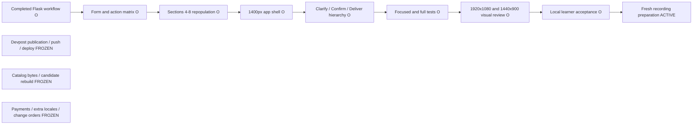

# Build Checklist

The competition build is English-only and globally neutral. `/en/<path>` is the only product route family. `catalog.en.json` is the only shipped catalog. The architecture retains a dormant catalog seam. User text accepted by the pinned fixed-document fonts remains unchanged; unsupported glyphs fail before JSON A is fixed. Payments, country-specific behavior, additional locales, remote push, deployment, and publication remain frozen until their listed slice.

- [x] **1. Revalidate the English-only fixed-document preflight**
  - Becomes usable: one command creates one English-labeled PDF, one English-labeled SVG, and one manifest in a unique read-only run directory.
  - Build: use the one English catalog, fixed label map, globally neutral sample, pinned Unicode-capable fonts, ReportLab, SVG rendering, SHA-256, fsync, no-overwrite installation, and quarantine.
  - Verify: `.venv/bin/python -m pytest -q tests/test_gate0.py tests/test_i18n_contract.py`.
  - Acceptance: `gate0-preflight-manifest/1.1`, `label_mode=english_only`, English system labels, Unicode user text unchanged, embedded fonts, nonblank raster, exact artifact set, and sanitized output.
  - Stop: any second locale, stale multi-language label, regional example, font/provenance failure, partial reviewable output, overwrite, or digest mismatch.
  - Evidence: 33 Gate 0-focused tests and the 55-test full suite passed; Gate 0 run `e880cccbdece9afac6407f8bfea6d079` produced manifest schema `gate0-preflight-manifest/1.1`, `label_mode=english_only`, one PDF, and one SVG with verified SHA-256 values.
  - Learner check: retained for the Slice 2 checkpoint under fast mode.
  - Commit: `Converge competition build to English only`

- [x] **2. English client guide, secure accounts, private cases, and immutable JSON A**
  - Becomes usable: a demonstration client signs in, completes eight sections under `/en`, reviews a safe blueprint, and downloads exact saved JSON A bytes.
  - Build: users, cases, Flask session, CSRF, administrator isolation, English catalog-backed templates, strict JSON A 1.1, currency code plus integer amounts, immutable storage, SHA-256 downloads, and Unicode-safe user content.
  - Verify:

    ```bash
    .venv/bin/python -m pytest -q \
      tests/test_auth_csrf.py \
      tests/test_permissions.py \
      tests/test_json_contracts.py \
      tests/test_i18n_contract.py
    ```

  - Acceptance: only `/en` is registered; `/zh-TW`, other locale prefixes, and unprefixed product paths return 404; only `catalog.en.json` ships; unsupported catalog keys fail closed; client content survives Unicode round trips; administrator and third-party access fail; JSON A is stored once and rehashed on every download; restart preserves state and bytes.
  - Stop: auth, CSRF, transaction, permission, admin-isolation, exact-byte, no-overwrite, catalog, unsupported-locale, Unicode, or Gate 0 regression; any Slice 3 behavior.
  - Mechanical status: 43 Slice 2-focused tests and the 63-test full suite passed. A live browser pass also confirmed eight completed sections, readable wrapped blueprint nodes, Unicode display, and identical bytes from two JSON A downloads. The learner accepted the repaired Slice 2 interface on 2026-10-06.
  - Learner check: required after mechanical verification. Test the English owner journey, unsupported-locale rejection, Unicode text, blueprint, JSON A download, repeated-byte identity, and administrator isolation.
  - Commit: `Converge competition build to English only`

- [x] **3. One invitation binds one contractor and verifies the registered JSON A**
  - Becomes usable: the client creates a private invitation; the designated contractor accepts and imports the exact JSON A registered for the case.
  - Build: single-use expiring invitation, explicit party binding, server-owned identity and time, exact bytes and digest comparison, invitation states, and non-enumerating denial.
  - Verify: focused invitation, authorization, invalid-byte, wrong-version, duplicate-key, unknown-field, expiry, revocation, replay, and restart tests under `/en`.
  - Stop: third-party access, administrator bypass, identity accepted from upload, mismatched JSON A import, or public case discovery.
  - Mechanical status: forward-fix commit `236342a` passed 53 Slice 3-focused tests and the 81-test full suite. Independent review verified client navigation, same-case revoke binding with zero cross-case mutation, a locked pre-migration backup snapshot, and aligned PRD/Spec contracts.
  - Learner check: retained for the Slice 6 checkpoint.
  - Commit: `Add private invitation and requirement verification`

- [x] **4. Append-only case discussion and contractor-owned JSON B review**
  - Becomes usable: bound parties resolve questions; the contractor submits a validated JSON B version that the client can review and object to but cannot edit.
  - Build: append-only messages, issue states, JSON B private draft, reimport validation, source binding, scope, exclusions, milestones, responsibilities, acceptance, currency-aware fee items, expiry, and immutable review versions.
  - Verify: party-only access, draft privacy, append-only corrections, field objections, revision conflicts, strict parsing, computed totals, source digest binding, and no overwrite.
  - Stop: private draft disclosure, client editing contractor data, uploaded authority, implicit issue closure, float money, or source mismatch.
  - Mechanical status: 86 Slice 4-focused tests and the 120-test full suite passed, followed by dependency, compile, catalog, and diff checks. Independent product review verified field-attached objections without pointer syntax; independent security and staged-index reviews verified authorization, deferred-FK rollback, exact-byte replay, transaction-time expiry, immutable history, and the 25-file commit boundary.
  - Learner check: retained for the Slice 6 checkpoint.
  - Commit: `51f587c Add case discussion and JSON B review`

- [x] **5. One immutable English candidate manifest, PDF, and SVG**
  - Becomes usable: the contractor creates one candidate from fixed JSON A and JSON B snapshots; both parties preview and download the same files.
  - Build: one manifest, one English-labeled PDF, one English-labeled SVG, complete source and asset binding, one shared bounded blueprint model, safe markup, immutable storage, no-replace publication, directory fsync, recovery reconciliation, and quarantine.
  - Verify: candidate prerequisites, complete source-object binding, manifest-to-file binding, pointer and artifact coherence, one artifact of each type, English labels, accepted Unicode content, unsupported-glyph rejection before JSON A, complete node and edge labels, long-text wrapping, render and install failures, digest mismatch, no overwrite, restart, and unauthorized reads.
  - Stop: rerender on preview/download, locale-specific duplicate files, partial active candidate, unsafe SVG, stale source, or digest drift.
  - Mechanical status: 55 Slice 5-focused tests and the 154-test full suite passed, followed by dependency, compile, JSON, and diff checks. Independent product, security, and staged-index reviews verified width-aware CJK wrapping, catalog-backed headings, complete artifact binding, no-replace publication, directory fsync, quarantine recovery, authorization, CSRF, administrator isolation, and the absence of Slice 6 behavior.
  - Learner check: retained for the Slice 6 checkpoint.
  - Commit: `780bdad Add immutable English candidate manifest`

- [x] **6. Separate confirmations formalize the same candidate without rerendering**
  - Becomes usable: client and contractor independently acknowledge and confirm the same manifest. Two current confirmations formalize the existing files; a revision invalidates the round.
  - Build: lifecycle-neutral fixed-document wording, legacy-candidate invalidation, complete five-artifact acknowledgement, role-bound confirmations, withdrawal, change request, revision invalidation, partial unique constraints, `BEGIN IMMEDIATE`, immutable formal rows, verification page, and separate-proposal entry.
  - Verify: one-party pending, duplicate confirmation idempotency, withdrawal, same-user dual-role denial, source change, stale revision, unauthorized confirmation, confirm-versus-modify races, simultaneous confirmations, restart, unchanged inode and bytes, complete artifact-tuple binding, no rerender, formal-row immutability, and formal digest identity.
  - Stop: silent confirmation, expired-time consent, different reviewed bytes, source change after confirmation, administrator bypass, or formal-file replacement.
  - Mechanical status: commit `c2c6367` passed 38 Slice 6-focused tests and the 171-test full suite, followed by dependency, compile, JSON, HTML-table, and diff checks. Independent product, security, and staged-index reviews returned O after repairs for empty follow-up proposals, complete formal evidence revalidation, historical asset independence, and valid planning-document tables.
  - Learner check: passed on 2026-10-06. The learner invalidated one round, rebuilt a candidate, completed acknowledgement and confirmation as both roles in separate login sessions, reached formal verification, and started a separate empty proposal.
  - Commit: `Add bilateral same-byte formalization`

- [x] **7. Delivery, acceptance, remediation, evidence export, and factual ship artifacts**
  - Becomes usable: the contractor delivers against the formal version; the client accepts or returns specific items; remediation and reinspection preserve history; a bound party exports evidence without private drafts.
  - Build: immutable delivery and test records, inspection item results, remediation, reinspection, explicit acceptance, deadline events without consent, disputes, party-only export, English README, English demo guide, and factual English submission evidence.
  - Verify: complete English end-to-end journey, returned item, remediation, acceptance, dispute, export contents, private-draft exclusion, log redaction, restart, outbound-network denial, and bounded loopback subprocess cleanup.
  - Stop: automatic acceptance, platform adjudication, formal-file change, private draft in export, payment behavior, public publishing, remote push, or deployment.
  - Mechanical status: commit `c619738` passed 56 focused checks with one sandbox-only loopback skip, the 202-test full regression suite with the same single skip, and a separate permitted loopback run with one pass and confirmed port release. Independent product, security, and exact staged-index reviews returned O after repairs for exact acceptance identity, the 20-version cap, append-only child records, evidence-export fingerprint verification, safe archive entries, startup/read-time reconciliation, and the 25-file commit boundary. Responsive follow-up commit `e7b7306` added an accessible contained table scroller, passed all 28 Slice 7 delivery/migration tests, and raised the full regression result to 203 passed with the same single sandbox-only loopback skip. Dependency, compile, schema, planning-renderer, diff, and secret-boundary checks also passed.
  - Learner check: passed on 2026-10-07. After reviewing the completed App Map and prior hands-on evidence, the learner explicitly stated, "The PoC is ready to enter 6-ship." An isolated proxy audit completed delivery, returned inspection, remediation, reinspection, explicit acceptance, history review, and evidence export; all 10 manifest entry digests matched. The final narrow-viewport repair was independently verified at 660 and 789 CSS-pixel viewports without whole-page overflow or per-letter fragmentation.
  - Commit: `Complete delivery review and English ship evidence`

## Hands-On Checkpoints

- [x] Slice 2: English owner journey, unsupported locale, Unicode input, blueprint, JSON A exact bytes, and administrator isolation. Learner accepted the repaired review interface on 2026-10-06.
- [x] Slice 6: invitation through same-byte formalization in separate client and contractor sessions. Accepted by the learner on 2026-10-06.
- [x] Slice 7: delivery, remediation, acceptance, dispute evidence, export, and English documentation. Mechanical and isolated proxy audits passed; the learner approved entry to `6-ship` on 2026-10-07.

Fast mode adds no other human pause. Mechanical gates and independent verification still run for every slice.

## Historical Local Desktop UI Refactor — STALE

The evidence in this section records the earlier desktop-shell review and is retained for history. It was superseded by the human-workflow and artifact-compatibility repair in commit `c5c9d07`; its old catalog hash, test counts, diff scope, and temporary visual artifacts do not prove the current build. Publication, Devpost final submission, remote push, deployment, payments, additional locales, and change-order work remain frozen until the current gates pass.



### Form and action preservation matrix

| Surface | Method and action | Preserved contract | Primary user action |
| --- | --- | --- | --- |
| Session | `POST /en/login`, `POST /en/logout` | CSRF, generic login errors, session reset | Sign in or sign out |
| Client requirements | `POST /en/owner/requirements`; `POST` to sections 1–8 | CSRF, `expected_revision`, all existing field names | Create draft or save and continue |
| JSON A and invitation | Existing JSON A, preview, invitation, revoke, accept, reject, and import routes | Exact upload bytes, multipart names, `expected_revision`, invitation binding | Create or verify the private case |
| Case discussion | Existing message and issue event routes | CSRF, `idempotency_key`, `correction_of_id`, `expected_revision` | Resolve the current question |
| JSON B | Existing draft, export, import, objection, revise, and candidate routes | CSRF, `expected_revision`, `artifact_id`, multipart file names | Submit the current proposal version |
| Candidate confirmation | Existing acknowledgement, confirmation, withdrawal, and revision routes | CSRF, candidate identity, `expected_revision` | Confirm or request revision |
| Formal version | Existing verification downloads and separate-proposal route | Same stored bytes, `idempotency_key`, party authorization | Continue to delivery |
| Delivery | Existing delivery, inspection, dispute, position, and evidence-export routes | CSRF, `expected_revision`, `idempotency_key`, dynamic criterion field names | Perform the state-appropriate next action |
| Administration | Existing account status and service-health routes | CSRF, application-level content isolation | Manage accounts or check service health |

### Refactor gates

- [x] Sections 4–8 restore every saved value before step or Back navigation.
- [x] A shared desktop shell shows role, understandable status, workflow position, next action, and one primary CTA.
- [x] The home page communicates the problem and Clarify, Confirm, Deliver within the first viewport.
- [x] Candidate, formal, delivery, and case pages move UUIDs, hashes, manifests, raw JSON, and event history below the main task inside closed verification or history details.
- [x] Client, contractor, and administrator pages use the same shell; administrator pages state that administrators cannot access private case content.
- [x] No catalog, schema, PDF, SVG, manifest, persisted case data, route, request method, or security boundary changes.
- [x] Focused form-contract and authorization tests pass before the full suite.
- [x] Local 1920×1080 and 1440×900 review artifacts confirm the first viewport contains product purpose, user role, current status, next action, and no raw UUID, hash, manifest, or JSON dump.
- [x] Local visual acceptance completed; advance only recording preparation. Keep Devpost publication, remote push, and deployment frozen until the local media gate passes.

### Verification evidence

- [x] `app/i18n/catalog.en.json` remains exactly SHA-256 `9b028ffb3a846ba7ae43880ef7a0746f8cb1fb88b18d2e5212478af1a063f3fc`.
- [x] Every rendered action state exposes at most one `data-ui="primary-action"` element.
- [x] Role, human-readable status, workflow stage, and next action use stable `data-ui` hooks.
- [x] Technical verification and history use closed `details` elements without the `open` attribute.
- [x] POST actions, methods, encodings, CSRF fields, concurrency fields, idempotency keys, artifact bindings, correction bindings, and dynamic acceptance-criterion names match the pre-refactor contract.
- [x] CSP remains self-only and templates add no remote script, stylesheet, image, font, frame, or form target.
- [x] Focused UI, authorization, route, and workflow tests pass: 63 passed.
- [x] The complete regression suite passes: 219 passed and one sandbox-only loopback test skipped.
- [x] Browser review passes at 1920×1080 and 1440×900; existing automated responsive-width checks also pass.
- [x] Git diff contains no catalog, schema, document renderer, migration, runtime data, remote, or deployment change.

Temporary local review artifacts `service-requirement-blueprint-ui-review-1920x1080.html` (SHA-256 `4a36887ae017ef841a0d5d1f2a64be193eda4cea47a254846916a636d37aeb44`) and `service-requirement-blueprint-ui-review-1440x900.html` (SHA-256 `9beae3bedc0545e917b7251e02807147fe00298e7b423b1f5bf46870cdc260e7`) contain eight synthetic, de-identified, self-contained review surfaces and no runtime credentials or external assets.

## Historical Recording Workflow Repair Checkpoint — Recording Frozen

Functional repair head: `f0cc808bfec8b1b1c34aa017a7d02fabca139d78` (base repair `8164bf175c30679a3703e0ef8b7f5116cf40eaa5`).

The checked results below belong to that earlier head. The identity of any later release candidate comes from its generated `public-export-manifest.json` and fresh independent receipts. These historical checks do not count toward the five current browser passes.

- [x] Historical `CURRENT` confirmation versions remain readable after catalog and document-template rotation; saved manifest, PDF, and SVG bytes remain unchanged.
- [x] Case-room issue handling gives the eligible role one explicit primary action for proposing or accepting the treatment before confirmation can continue.
- [x] UI and PDF rendering share a field-aware semantic registry. Known schema enums and machine-style codes are humanized while user-authored notes remain unchanged.
- [x] Invitation status and tasks use centralized role/state mappings; exact source identity stays in a closed verification disclosure.
- [x] The recording graph, route-accurate shot list, 14-asset production package, and 105-second subtitle contract use the same objection, revision, treatment, acceptance, confirmation, delivery, and evidence order.
- [x] Stale Evidence ZIP downloads are rejected after the case evidence changes; unchanged current evidence reuses the same stored ZIP bytes.
- [x] JSON B objections are role-bound and the client's acceptance is bound to the proposal artifact the contractor actually referenced.
- [x] The formal page gives both parties exact-byte downloads for JSON A, JSON B, PDF, SVG, and manifest; outsiders remain denied.
- [x] The public-candidate builder reads one exact clean Git commit, binds its tree and file inventory, verifies bundled font provenance, and fails closed on dirty input, overwrite, missing files, digest mismatch, or private absolute paths.
- [x] `app/i18n/catalog.en.json` SHA-256 is `5fbfd7fb9371c2b82a0635e73974aa958ff39eeed140892bda4ba13731b0ccb4`.
- [x] Focused repair checks pass: 94 passed.
- [x] Complete regression passes: 283 passed.
- [x] The Claude Cloud review of source commit `6a13baf93e75f6b96b4a5f4d931cfe759fa96d9c` reported 0 P0 and 7 P1 findings; all seven P1 repairs are included in base repair `8164bf175c30679a3703e0ef8b7f5116cf40eaa5`, and click-preflight recovery fixes are included in functional head `f0cc808bfec8b1b1c34aa017a7d02fabca139d78`.
- [x] Independent read-only re-review of the functional repair head: PASS with 0 remaining P0/P1 findings; 4 focused checks passed.
## Current source synchronization and submission handoff

The learner authorized the latest sanitized source synchronization. Its generated `public-export-manifest.json` and public security receipts identify the exact candidate; prior test counts and browser passes above remain historical. Independent current static review found the UI form/CSRF/role contracts intact. The extracted current candidate passed 322 tests with one sandbox loopback skip; that server start/stop test passed separately. Exact source and public-package inventory checks passed. Final security receipts and post-push readback close synchronization; generated receipts distinguish the tested source from a later documentation-only status correction.

The edited video candidate is now 161.8 seconds at 1.1× speed, with 23 scenes and 39 subtitle cues. The earlier 105-second contract is superseded. `demo-capture-guide.md`, `demo-shot-list.md`, `demo-voiceover.txt`, and `demo-script.srt` describe the current edit. Recorded actions, stills, illustrations, and off-camera artifact checks have distinct evidence limits.

Remaining submission gates are continuous human audiovisual review, a hosted video URL, learner review of the AI-assisted English draft, personal eligibility answers, and the exit survey. Deployment and peer feedback remain optional. No unchecked historical recording row is treated as a current source failure, and no source synchronization is treated as Devpost submission approval.

## Final Review

- [x] Feedback resolved and affected English routes, artifacts, and documents retested.
- [x] Learner confirms readiness to enter `6-ship`.

## Code Tour and App Map

- [x] Guided code tour or focused recap completed during the Slice 7 session.
- [x] Optional learner edit and transfer reflection addressed.
- [x] `devpost/app-map.html` generated from finished code, checked, and shown in English.

Activity and evidence: the focused recap used the actual delivery-history repair; browser measurements established contained table overflow, and `test_delivery_history_uses_accessible_responsive_table_region` preserves the DOM/CSS contract. The learner then reviewed the finished App Map and approved entry to `6-ship`.

Route and stops: reference route from `app/routes/localized.py::delivery_submit` to `app/services/delivery_workflow.py::submit_delivery`, then `app/templates/delivery_dashboard.html` and the end-to-end Slice 7 test.

Edit outcome: the responsive wrapper and grid-item width constraint were kept in commit `e7b7306`; 28 focused tests and the 203-test full regression suite passed.

Reflection: the optional transfer question was answered. The content remains only in the ignored learner profile, as required by the official skill.

Activity mode: focused evidence recap completed with the verified offline App Map.

## Revisions

- 2026-10-06: Superseded the prior multi-language competition contract. The current target is English-only, globally neutral, Unicode-safe, and localization-ready without shipping another catalog or route family. Earlier Gate 0 and Slice 2 evidence is stale until this checklist's first two mechanical gates pass again.
- 2026-10-06: Live Slice 2 review found two boundary defects. The public fixture now uses the ISO 4217 testing code `XTS`, the UI no longer suggests a regional currency, and long blueprint labels wrap inside fixed nodes instead of overlapping. Regression tests cover both repairs.
- 2026-10-06: The learner reviewed the live Slice 2 page, asked for clarification about the blueprint and Unicode test sentence, then explicitly accepted Slice 2 after the interface and test-data purpose were explained.
- 2026-10-06: Reopened Slice 3 after commit `1c7acf3` when a later boundary review found client-navigation, cross-case revoke, canonical-document, and migration-snapshot gaps. Slice 4 remains frozen until a forward-fix commit and independent re-verification pass.
- 2026-10-06: Closed the Slice 3 forward-fix gate in commit `236342a`. The exact staged candidate passed 53 focused tests, 81 full tests, dependency and compile checks, plus an independent staged-index review; Slice 4 may now begin.
- 2026-10-06: Closed Slice 4 in commit `51f587c`. Review-driven repairs moved quote-expiry validation into the writer transaction, preserved successful exact-byte replay after expiry, kept deferred foreign keys active through COMMIT, aligned service and database limits, verified idempotent exports, protected newer private revisions, exposed append-only correction and issue history, constrained actions by state and role, and replaced client-entered JSON pointers with field-attached objection controls.
- 2026-10-06: Closed Slice 5 in commit `780bdad`. The fixed candidate uses one immutable manifest, PDF, and SVG; exact source and asset binding; pinned-font width-aware wrapping; no-replace publication with directory fsync; protected same-byte reads; startup reconciliation; and quarantine recovery. Independent product, security, and staged-index reviews returned O with no Slice 6 drift.
- 2026-10-06: Slice 6 review found that a candidate-only sentence embedded in the PDF would contradict same-byte formalization. Template `candidate-document/1.1` now uses lifecycle-neutral wording. Migration 005 preserves existing files and rows but invalidates superseded candidates so they must be rebuilt before acknowledgement.
- 2026-10-06: Slice 6 mechanical implementation closed in commit `c2c6367`. Formal reads revalidate the round, exact parties, and complete five-artifact evidence; historical formal files remain readable after renderer-asset rotation but fail closed on saved-evidence tampering. The learner checkpoint remains pending and Slice 7 stays frozen.
- 2026-10-06: The learner passed the Slice 6 hands-on checkpoint after invalidating the first candidate, creating a replacement, confirming it through both bound roles, reaching the formal verification page, and opening a separate empty proposal. Slice 7 may begin under fast mode.
- 2026-10-06: Slice 7 product and security verification returned O after the delivery, remediation, explicit acceptance, dispute evidence, and bounded export paths were repaired and retested. The full suite passed 202 tests with one sandbox-only loopback skip; the same loopback test passed separately with the port released. Exact staged-index verification and the learner checkpoint remain pending.
- 2026-10-06: Closed the Slice 7 mechanical gate in commit `c619738`. The exact 25-file staged index passed independent review with no runtime data, secrets, extra locale, payment, adjudication, deployment, publication, or remote drift. The learner checkpoint remains pending; app-map and code-tour work remain deferred until learner acceptance.
- 2026-10-06: An isolated proxy audit verified initial delivery, returned inspection, remediation, explicit acceptance, immutable history, and a 10-entry digest-valid Evidence ZIP. Follow-up commit `e7b7306` contains the six-column delivery table inside an accessible horizontal scroller; independent checks at 660 and 789 CSS-pixel viewports found no whole-page overflow or per-letter fragmentation. This is technical evidence only: the learner checkpoint and readiness decision remain pending.
- 2026-10-06: Generated and browser-checked `devpost/app-map.html` from finished commit `63c71d2`. The offline English map traces delivery submission across the route, workflow service, dashboard, and end-to-end test; it also records the responsive repair as a reusable evidence practice. No script, remote asset, credential, private case data, or network dependency is embedded.
- 2026-10-06: Corrected the premature Slice 7 learner-acceptance wording introduced by commit `63c71d2`. Proxy and independent audit results remain valid, but neither grants learner approval or permission to enter `6-ship`.
- 2026-10-07: The learner reviewed the completed App Map, answered the optional transfer question, and explicitly stated that the PoC is ready to enter `6-ship`. The private reflection remains in the ignored learner profile. This closes the Slice 7 learner checkpoint, Final Review, and focused recap without authorizing publication, remote push, deployment, video upload, or Devpost submission.
