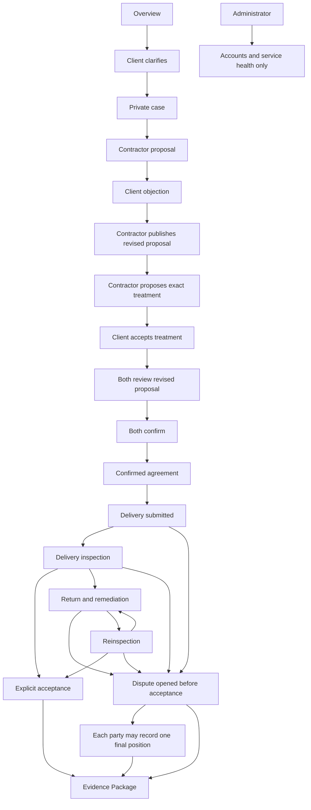

# Frontend Flow Map

This is the presentation contract for the competition build. The main path below shows the accepted-case recording journey; the dispute branch shows the product path that is not filmed. The table maps each human-facing screen to its role, saved state, single primary action, expected result, and recording evidence. Internal route names may retain implementation vocabulary; visible labels follow the human workflow.

`app/presentation.py` owns the granular workflow-state, issue-state, issue-kind, screen-slot, and catalog-key mappings. The shared eight-stage display mapping—Clarify, Quote, Review, Confirm, Deliver, Inspect, Fix, and Evidence—lives in `app/templates/_ui.html`; every core page calls its shared macros for the context bar, workflow drawer, and visible stage label. Pages must not independently override stage labels or the granular labels supplied by `ui(...)`, `ui_state(...)`, `ui_issue_state(...)`, and `ui_issue_kind(...)`.

## Screen-to-state contract

| Screen | Role | Route pattern | Required saved state | Visible status or purpose | Action shown | Expected next result | Engineering evidence boundary | Demo cue |
| --- | --- | --- | --- | --- | --- | --- | --- | --- |
| Overview | Signed out | `/en/` | None | Choose Client, Invited contractor, or Administrator | Client: **Start** | Role-specific sign-in | No account identifiers or runtime details | Supporting orientation only |
| Sign in | All roles | `/en/login` | Approved account exists | Explain the selected role without granting authority | **Sign In** | Role-authorized workspace | Password starts empty; no initialization note | Never record password entry |
| Client guide | Client | `/en/owner/guide` | Authenticated member | Explain the eight guided sections | **Create Private Draft** | Requirement section 1 | No schema or database terms | Setup only |
| Requirement section | Client | `/en/owner/requirements/<case_id>/sections/<section_no>` | `REQUIREMENT_DRAFT` | Collect one understandable group of decisions | **Save and Continue** | Next section or review | Technical source stays out of the page | Prefilled material only |
| Requirement review | Client | `/en/owner/requirements/<case_id>/review` | Draft may be incomplete; eight sections required to save | Human summary of pages, features, deliverables, acceptance, and unresolved items | **Continue requirement** until complete, then **Save Requirement Version** | Next missing section or Saved Version panel | Raw requirement record stays in closed **Verify this saved requirement** | Interactive workflow reference |
| Private invitation | Client | `/en/owner/requirements/<case_id>/publish` | Saved requirement version | Verify the saved requirement, then invite exactly one contractor | **Preview Saved Requirement**, then **Create Private Invitation** | Pending invitation | Invitation token never appears in recording | Preparation only |
| Invitation review | Contractor | `/en/invitations/<invitation_id>` | Pending invitation | Identify client and requirement boundary | **Accept Invitation** | Requirement import | Exact saved record remains in a closed verification panel | Preparation only |
| Closed invitation | Contractor | Same invitation route | Revoked, rejected, expired, or invalidated invitation | Show a closed state without the live case title or workflow state | None | Ask the client for a new invitation if needed | No live case details or acceptance action leak through the closed route | Preparation safety check |
| Accepted invitation | Contractor | Same invitation route | Accepted invitation and unchanged saved requirement | Direct the contractor to import the requirement, or to the active case after import | **Import Saved Requirement** or **Open Private Case** | Import screen or current case workflow | Case details and destination appear only while this contractor remains bound | Preparation only |
| Requirement import | Contractor | `/en/cases/<case_id>/json-a/import` | Invitation accepted; contractor bound | Upload the exact saved requirement supplied by the client | **Verify Requirement Source** | Verified private case | Use the prepared exact JSON A; never expose a local path or file picker in recording | Preparation only |
| Private case | Client or contractor | `/en/cases/<case_id>` | Both parties bound | One case, two named parties, current issue and proposal actions | **Review Proposal**, **Prepare Proposal**, or resolve the current issue as the saved state allows | Proposal draft, review, or issue resolution | In `CASE_ACTIVE`, a contractor can still open the proposal draft while a clarification is open; requirement identifiers and hashes stay in closed verification | Interactive workflow reference |
| Proposal draft | Contractor | `/en/cases/<case_id>/json-b/draft` | `JSON_B_PRIVATE_DRAFT` or revision requested | Define included scope, exclusions, responsibilities, fees, and acceptance | **Save Private Proposal Draft** | Saved private draft | The recording shows a prepared editor state without typing raw content | Interactive workflow reference |
| Proposal handoff | Contractor | `/en/cases/<case_id>/json-b/review/import` | Fixed private proposal file exists | Publish the same saved file for both parties to review | **Submit Proposal for Review** | Party-visible review version | The recording shows the prepared upload screen without opening the file picker or exposing a path | Interactive workflow reference |
| Proposal review | Client | `/en/cases/<case_id>/json-b/reviews/<version_no>` | Current proposal version | Show included and excluded work in readable cards | **Raise Objection** inside a closed disclosure; this is a secondary action | Objection visible in case history | Proposal hash stays in closed verification; field pointer remains a hidden validated input | Interactive workflow reference |
| Blocked proposal review | Contractor | Same review route | Unresolved objection exists | Tell the contractor to revise; do not permit confirmation creation | **Revise Proposal** | Editable revision draft | Confirmation creation must be absent | Interactive workflow reference |
| Expired proposal review | Contractor | Same review route | Current quote expired | Show expiry before consent and direct the contractor to update the quote | **Revise Proposal** | Editable revision draft with a new expiry required | Confirmation creation must be absent | Rehearsal safety check |
| Issue resolution | Contractor then client | `/en/cases/<case_id>` | Revised proposal exists; objection remains open | Both parties can reopen the current proposal before the contractor proposes treatment and the client accepts that same revision | **Propose Resolution**, then **Accept Resolution** | Objection becomes resolved | Proposal review remains a secondary link; issue history remains readable and raw state codes stay mapped | Interactive workflow reference |
| Revised proposal review | Both parties | `/en/cases/<case_id>/json-b/reviews/<version_no>` | Current proposal version 2 and resolved objection | Contact form included; unlimited revisions excluded | Contractor: **Create Confirmation Version** | Shared confirmation version | Identifiers stay hidden or inside closed verification | Interactive workflow reference |
| Confirmation version | Each party | `/en/cases/<case_id>/candidates/<candidate_id>` | `CANDIDATE_REVIEW` | Review the same saved agreement and diagram | **Acknowledge Version**, then **Confirm This Version** | One party waits; the second confirmation finalizes | IDs and file digests stay in closed **Verify this confirmation version** | Interactive workflow reference |
| Confirmed agreement | Each party | `/en/cases/<case_id>/formal` | `FORMAL` | Show both confirmations and the unchanged delivery baseline | **Open Delivery Review** | Delivery workflow | Agreement PDF and scope diagram remain accessible; digests stay collapsed | Interactive workflow reference |
| Delivery submission | Contractor | `/en/cases/<case_id>/delivery` | `FORMAL` | Submit work and criterion-specific evidence | **Submit Delivery Version** | Client can begin inspection | Confirmed-version details stay collapsed | Interactive workflow reference |
| Inspection | Client | Same delivery route | `DELIVERED` or `UNDER_ACCEPTANCE` | Check every agreed criterion | **Begin Inspection**, then **Submit Inspection** | Acceptance or remediation | No silence-based acceptance | Interactive workflow reference, then Interactive workflow reference |
| Remediation | Contractor then client | Same delivery route | `REMEDIATION` then `REINSPECTION` | Preserve the first delivery and show the specific return reason | **Submit for Reinspection**, then explicit acceptance | `ACCEPTED` | Earlier versions remain in closed history | Interactive workflow reference |
| Dispute and positions | Either party | Same delivery route | `DISPUTED` before acceptance | Preserve the fixed agreement, delivery, inspection, and each party's position without deciding an outcome | **Submit Final Position** when that party has not already done so | Party-only evidence export remains available | No winner, liability, damages, refund, or payment decision | Product branch, not filmed |
| Evidence Package | Either party | Same delivery route | `ACCEPTED` or `DISPUTED`; a final position is optional | Portable agreement and delivery history | **Download Evidence Package (.zip)** | Direct ZIP response on the first click | ZIP internals, manifest, hashes, and filesystem path are not shown | Interactive workflow reference |
| Service health | Administrator | `/en/admin/service-health` | Authenticated administrator | Service ready or attention required; private cases inaccessible | None | Remain in operator boundary | Detailed checks stay in closed operator details | Interactive workflow reference |

## Non-regression rules

1. Every workflow state exposes at most one element marked `data-ui="primary-action"` for the current role.
2. A blocking proposal objection removes **Create Confirmation Version** and leaves **Revise Proposal** as the only primary action.
3. Revision does not resolve an objection: the contractor must propose a treatment and the client must accept that exact issue revision before confirmation creation appears.
4. One confirmation must show a waiting state and must not finalize the agreement.
5. Delivery acceptance requires an explicit client action.
6. The first Evidence Package click must prepare or reuse the package for the current evidence state and return that ZIP attachment.
7. Client, contractor, and administrator authorization comes from the server-side session and permissions, never from a role query parameter.
8. Raw identifiers, digests, manifests, record pointers, and machine documents stay inside closed verification panels or downloads.
9. The administrator surface must not expose private requirement, proposal, message, attachment, delivery, or acceptance content.
10. Recording routes must use synthetic isolated data and must never expose passwords, invitation codes, session values, local paths, terminal output, or canonical database content.

## Verification links

- UI and form contract: `tests/test_ui_contract.py`
- Proposal and objection workflow: `tests/test_slice4_routes.py`
- Confirmation lifecycle: `tests/test_formalization_workflow.py`
- Delivery, remediation, acceptance, and Evidence Package: `tests/test_slice7_delivery.py`
- Role and case isolation: `tests/test_permissions.py`
- Current video composition and factual limits: `devpost/demo-production-package.md` and `devpost/demo-capture-guide.md`
- Current 23-scene edit and route references: `devpost/demo-shot-list.md`; complete click order: `devpost/demo-guide.md`
